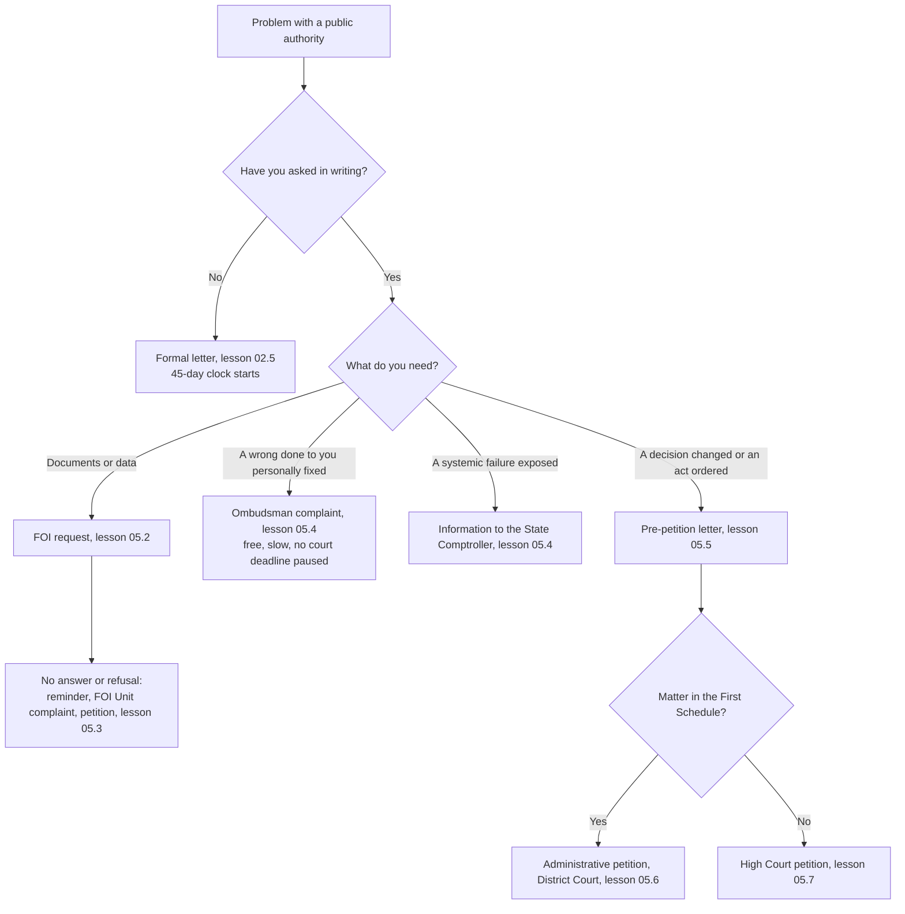

# 05.1 · Choosing the Right Tool

By the end of this lesson you will be able to look at a problem with a public authority and choose the right tool for it — a letter, a Freedom of Information request, a complaint to an oversight body, a pre-petition letter or a court petition — in the right order, with the deadline each one starts or stops written in your plan.

## Why it matters

Activists lose more cases to the wrong tool than to the wrong argument. A complaint to the ombudsman does not stop the 45-day clock for a petition. A petition filed in the High Court when the law sends it to the District Court is struck out, and the fee is spent. A petition without a prior written demand is dismissed for not exhausting remedies (lesson 04.5). A Freedom of Information request used to ask for a *decision* gets an answer about documents, not action.

Each tool in this module does one job well. This lesson is the map; lessons 05.2–05.7 teach each tool in detail.

## Key terms

| עברית | Transliteration | English |
|---|---|---|
| ארגז כלים | argaz kelim | Toolbox: the set of procedures you can use against an authority |
| בקשת חופש מידע | bakashat chofesh meida | Freedom of Information (FOI) request |
| תלונה לנציב תלונות הציבור | tluna lenetziv tlunot hatzibur | Complaint to the Public Complaints Commissioner (ombudsman) |
| מכתב התראה לפני עתירה | michtav hatra'a lifnei atira | Pre-petition letter (warning letter before a petition) |
| עתירה מינהלית | atira minhalit | Administrative petition, heard by a District Court sitting as an Administrative Court |
| עתירה לבג״ץ | atira leBagatz | Petition to the High Court of Justice |
| התוספת הראשונה | hatosefet harishona | The First Schedule of the Administrative Courts Law: the list of matters the Administrative Court hears |
| מיצוי הליכים | mitzui halichim | Exhausting remedies: asking the authority before going to court |
| שיהוי | shihui | Delay: waiting too long before petitioning, a ground for dismissal |

## The law

> (א) נתבקש עובד הציבור, בכתב, להשתמש בסמכות שניתנה לו על פי דין, יחליט בבקשה וישיב למבקש בכתב בהקדם, אך לא יאוחר מארבעים וחמישה ימים מיום קבלת הבקשה.

*Gist:* a written request to use a power starts a 45-day clock for a written decision — the starting point of almost every tool. ([חוק לתיקון סדרי המינהל (החלטות והנמקות), s. 2](https://he.wikisource.org/wiki/חוק_לתיקון_סדרי_המינהל_%28החלטות_והנמקות%29#סעיף_2))

> לכל אזרח ישראלי או תושב הזכות לקבל מידע מרשות ציבורית בהתאם להוראות חוק זה.

*Gist:* every citizen or resident has a right to receive information held by a public authority. ([חוק חופש המידע, s. 1](https://he.wikisource.org/wiki/חוק_חופש_המידע#סעיף_1))

> (1) עתירה נגד החלטה של רשות או של גוף המנוי בתוספת הראשונה בענין המנוי בתוספת הראשונה ולמעט עתירה שהסעד העיקרי המבוקש בה ענינו התקנת תקנות, לרבות ביטול תקנות, הכרזה על בטלותן או מתן צו להתקין תקנות (להלן – עתירה מינהלית);

*Gist:* the Administrative Court hears petitions only in matters listed in the First Schedule (FOI, planning, education, tenders, local authorities and many more), and never petitions whose main remedy concerns regulations. ([חוק בתי משפט לענינים מינהליים, s. 5](https://he.wikisource.org/wiki/חוק_בתי_משפט_לענינים_מינהליים#סעיף_5))

> (ג) בית המשפט העליון ישב גם כבית משפט גבוה לצדק; בשבתו כאמור ידון בענינים אשר הוא רואה צורך לתת בהם סעד למען הצדק ואשר אינם בסמכותו של בית משפט או של בית דין אחר.

*Gist:* the High Court of Justice hears what no other court or tribunal can hear — so if a matter is in the First Schedule, the HCJ is the wrong forum. ([חוק-יסוד: השפיטה, s. 15(ג)](https://he.wikisource.org/wiki/חוק-יסוד:_השפיטה#סעיף_15))

> (2) אין בהם כדי למנוע מהמתלונן או מאדם אחר להשתמש בזכות או לבקש סעד שהוא זכאי להם, אולם אם נקבע לכך מועד בחיקוק, לא יוארך המועד על ידי הגשת התלונה או בירורה.

*Gist:* an ombudsman complaint does not extend any legal deadline, such as the deadline for a petition. ([חוק מבקר המדינה, s. 45(א)(2)](https://he.wikisource.org/wiki/חוק_מבקר_המדינה#סעיף_45))

## How it works in practice

### The decision tree

### What each tool gives you

| Tool | What it gets you | Cost | Typical time | Clock it starts or runs against |
|---|---|---|---|---|
| Formal letter (02.5) | A written decision with reasons | Postage | 45 days by law | Starts the 45-day duty to decide |
| FOI request (05.2) | Documents and data the authority holds | Small fee; exemptions exist | 30 days, extendable | Starts the FOI answer period |
| FOI Unit complaint (05.3) | Pressure on a ministry that ignores FOI | Free | Weeks | Does not pause the petition clock |
| Ombudsman complaint (05.4) | Investigation of a wrong done to you, a recommendation to fix it | Free | Months | Does not pause any legal deadline; one year to complain |
| Information to the State Comptroller (05.4) | A possible audit of a systemic failure | Free | No answer guaranteed | None |
| Pre-petition letter (05.5) | Exhausts remedies; often solves the case | Postage | 7–30 days you set | Must leave time inside the petition deadline |
| Administrative petition (05.6) | A court order against an authority in a First Schedule matter | Court fee or exemption | Months | 45 days from the decision |
| HCJ petition (05.7) | A court order in any other public-law matter | Court fee or exemption | Months to years | "Without delay" (שיהוי) |

The fees are on [Current Numbers](../../references/current-numbers.md).

### Order matters

1. **Ask first, in writing.** Nearly every tool requires it, and courts check it.
2. **Get the facts before you argue.** An FOI request often shows the authority's real reasons and saves you a weak petition.
3. **Use free pressure before paid pressure,** but never let a complaint run past a court deadline.
4. **Write the deadlines in one calendar.** Each tool has its own clock; the earliest one governs.

### Finding the right court

Open the [First Schedule](https://he.wikisource.org/wiki/חוק_בתי_משפט_לענינים_מינהליים) and search (Ctrl+F) for your subject: "חופש המידע", "תכנון ובניה", "חינוך", "מכרזים", "רשויות מקומיות". Read the item to the end: many items exclude decisions of the government or a minister, or national rules. If your matter is listed and not excluded, the Administrative Court hears it. If it is not listed, or excluded, it goes to the HCJ. Lesson 01.4 has the map of courts.

## Worked example

**Situation.** A cellular company installs an antenna on the roof of a municipal community centre in a mixed Jewish–Arab town. Parents of children in the centre's after-school club want to know whether a permit exists, what the radiation measurements show, and to have the antenna moved if it is unlawful. Noa, a parent, will act in her own name; other parents will sign their own letters.

1. **Ask in writing.** Noa writes to the municipal engineer asking whether a building permit was issued and asking for removal if not (formal letter, 02.5). The 45-day clock starts on receipt.
2. **Get the data.** In parallel she files an FOI request to the municipality's FOI officer for the permit, the radiation measurement reports and the lease contract with the company (05.2). Radiation measurement results are information about the environment that an authority must publish (FOI Law s. 6א).
3. **Complaint?** A Commissioner complaint is possible — her child is directly affected — but it would not pause any deadline, so she keeps it as a back-up (05.4).
4. **Forum check.** A decision of a local planning committee is a planning matter: First Schedule, item 10 (תכנון ובניה). A petition, if needed, goes to the District Court sitting as an Administrative Court, not to the HCJ.
5. **Plan.** If the engineer refuses or stays silent, she sends a pre-petition letter (05.5) and keeps 45 days from the refusal in the calendar (05.6).

## Do it yourself

### You need

- The issue you mapped in project m01 or the memo from project m02.
- The [First Schedule](https://he.wikisource.org/wiki/חוק_בתי_משפט_לענינים_מינהליים) open in a tab.
- 40 minutes.

### Steps

1. Write your problem in one sentence: who, what decision or failure, what you want.
2. Name the authority and the official who holds the power (lesson 04.1).
3. Decide what you need first: documents, a personal wrong fixed, a systemic failure exposed, or a decision changed.
4. Walk the decision tree above and write the tools you will use, in order.
5. Check the First Schedule: is your matter listed, and is it excluded? Write the court you would petition.
6. Next to each tool, write the clock it starts and the date it ends.
7. Mark the earliest court deadline in red. Nothing else may run past it.

### Template

No new template. Use a table: `Tool | Purpose | Date sent | Deadline | Next step if it fails`. The letter templates come in lessons 05.2–05.5.

### How you know it worked

- Every tool in your plan has a purpose you can state in one line.
- You can name the court and the item of the First Schedule (or why it is not listed).
- No complaint or reminder in your plan runs past a court deadline.

### Self-check

- [ ] My first step is a written request (or I have already sent one).
- [ ] I know whether I need documents, a fix for myself, an audit or a court order.
- [ ] I checked the First Schedule item to the end, including its exclusions.
- [ ] Every deadline is in my calendar, and the earliest court deadline is marked.

## Learn more

- **Movement for Freedom of Information — "How to submit an information request" (איך להגיש בקשת מידע)** — FREE-FULL, Hebrew, 15 minutes: <https://www.meida.org.il/submit-an-information-request>. Read it for the overall flow: request, reminder, complaint, petition. Its fee figures are out of date; use Current Numbers. Fallback: lesson 05.2 covers the same steps.

## What goes wrong

| Mistake | Consequence | How to fix | How to avoid |
|---|---|---|---|
| Petitioning without asking first | Dismissed for not exhausting remedies | Send the request and a pre-petition letter, then re-file | Always start with a written request |
| Filing in the HCJ a First Schedule matter | Struck out or transferred; time lost | Ask for transfer, or re-file in the District Court quickly | Check the First Schedule and its exclusions |
| Waiting for the ombudsman while the petition clock runs | Petition dismissed as late | Ask the court for an extension, explaining the delay | Treat complaints as parallel, never as a pause |
| Using FOI to demand action | You get documents, not a decision | Send a formal letter asking for the act | Use FOI for information, letters for decisions |
| One tool at a time, slowly | Months lost; delay (שיהוי) argued against you | Run the letter and the FOI request in parallel | Plan the tools together at the start |

## Review

- Start with a written request: it starts the 45-day duty to decide and is the base of every later step.
- FOI gets documents; a complaint fixes a personal wrong; the Comptroller audits systems; a petition gets a court order.
- The First Schedule decides between the Administrative Court and the HCJ; read each item's exclusions.
- Complaints never pause court deadlines (State Comptroller Law s. 45(א)(2)).
- Write every tool's deadline in one calendar; the earliest court deadline governs.
