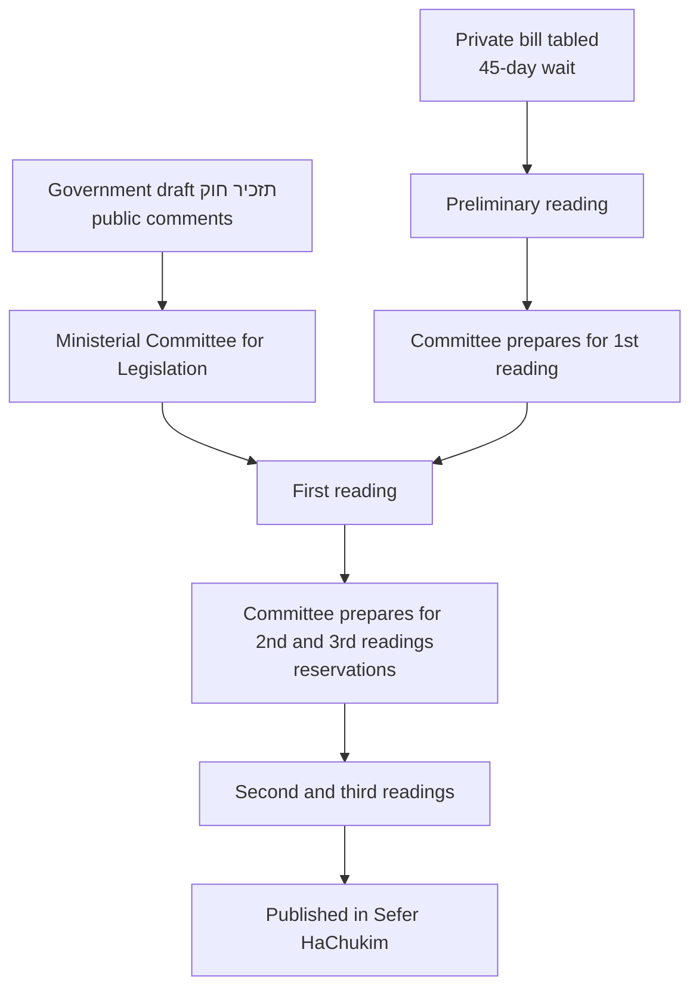

# 12.1 · How a Law Is Made

By the end of this lesson you will be able to follow any bill from its first draft to the Official Gazette, tell at a glance which stage it is in and what happens next, find its text and committee in the Knesset's free databases, and decide whether a bill that was pending when the 25th Knesset ended can still come back.

## Why it matters

Activists usually discover a bill when it is already on the plenum's agenda for a final vote. By then the text is fixed and the only tool left is a protest. The real work is done earlier, in the government's draft (תזכיר חוק) and in the committee that prepares the bill for its readings. If you know the map, you know when your comments can still change a word, whom to write to, and when it is too late.

Timing matters even more in October 2026. The 25th Knesset has been in its election recess since 18 July 2026, and elections to the 26th Knesset are set for 27 October 2026. Hundreds of bills are frozen. Most of them will die with the outgoing Knesset; a few can be revived by the new one. An activist who supports or opposes one of them needs to know which is which.

## Key terms

| עברית | Transliteration | English |
|---|---|---|
| הצעת חוק ממשלתית / פרטית / מטעם ועדה | hatza'at chok memshaltit / pratit / mita'am va'ada | Government bill / private member's bill / committee bill |
| תזכיר חוק | tazkir chok | Government draft bill published for comments before it reaches the Knesset |
| דיון מוקדם (קריאה טרומית) | diyun mukdam (kri'a tromit) | Preliminary reading, for private bills only |
| קריאה ראשונה / שנייה / שלישית | kri'a rishona / shniya / shlishit | First, second and third readings |
| הנחה על שולחן הכנסת | hanacha al shulchan haknesset | Tabling: the formal publication of a bill in the Knesset |
| הסתייגות | histaygut | Reservation: a proposed amendment voted on in the second reading |
| דין רציפות | din retzifut | Continuity: reviving a bill from the outgoing Knesset |
| פגרת בחירות | pagrat bechirot | Election recess |
| רשומות / ספר החוקים | reshumot / sefer hachukim | Official Gazette / the Laws series where a passed law is published |

## The law

> הצעת חוק תידון בכנסת בשלוש קריאות, והצעת חוק פרטית – גם בדיון המוקדם; חוק יתקבל בקריאה השלישית; הוראות חלק זה יחולו גם על חוקי־יסוד.

*Gist:* every bill goes through three readings, a private bill also through a preliminary reading, and a law is passed in the third reading; the same applies to Basic Laws. ([תקנון הכנסת, s. 74(א)](https://he.wikisource.org/wiki/תקנון_הכנסת#סעיף_74))

> הדיון המוקדם לא יתקיים לפני שעברו 45 ימים מיום שהונחה הצעת החוק על שולחן הכנסת

*Gist:* a private bill waits at least 45 days after tabling before its preliminary vote (unless the government agrees or the House Committee shortens the period), which gives the government and the public time to react. ([תקנון הכנסת, s. 76(ג)](https://he.wikisource.org/wiki/תקנון_הכנסת#סעיף_76))

> אושרה הצעת חוק בקריאה הראשונה, תכין אותה הוועדה שאליה הועברה לקריאה השנייה ולקריאה השלישית או תציע לכנסת להסירה מסדר היום

*Gist:* after the first reading the committee prepares the final text — or recommends dropping the bill; this is where most of the text is written. ([תקנון הכנסת, s. 84(א)](https://he.wikisource.org/wiki/תקנון_הכנסת#סעיף_84))

> הצעת חוק שהציעה ועדה של הכנסת או שהציע חבר הכנסת, ושכנסת יוצאת העבירה לאחר קריאה ראשונה לאחת מועדותיה, רשאית אותה ועדה ... להודיע במליאת הכנסת הנכנסת על רצונה שיחול עליה דין רציפות

*Gist:* a private or committee bill that passed its first reading in the outgoing Knesset can be continued by the new Knesset, on the committee's proposal; a government bill can be continued on the new government's request (s. 1). ([חוק רציפות הדיון בהצעות חוק, ss. 1–2](https://he.wikisource.org/wiki/חוק_רציפות_הדיון_בהצעות_חוק))

> הודעה כאמור בסעיף 1 או 2 לגבי הצעת חוק שהציע חבר הכנסת היוצאת, לא תימסר אלא אם כן אותו חבר הכנסת מכהן בכנסת הנכנסת ונתן את הסכמתו לכך.

*Gist:* a private bill can be continued only if at least one of its proposers is re-elected and consents. ([same, s. 3](https://he.wikisource.org/wiki/חוק_רציפות_הדיון_בהצעות_חוק))

> החליטה הכנסת להחיל רציפות ... תמשיך הכנסת הנכנסת, לדון בהצעת החוק ורשאית היא לנהוג בדיונים שנתקיימו בכנסת היוצאת כאילו היו אלה דיונים שלה.

*Gist:* once the plenum votes for continuity, the new Knesset picks the bill up where it stopped and may treat the old committee's work as its own. ([same, s. 6(ב)](https://he.wikisource.org/wiki/חוק_רציפות_הדיון_בהצעות_חוק); see also [תקנון הכנסת, s. 97](https://he.wikisource.org/wiki/תקנון_הכנסת#סעיף_97))

## How it works in practice

### The three routes into the Knesset

| Route | Who | Before the Knesset | First Knesset step |
|---|---|---|---|
| Government bill | The government as a whole (not one minister) | A **תזכיר חוק** is published for public and ministry comments; the Ministerial Committee for Legislation approves; the bill is published in Reshumot | First reading |
| Private member's bill | One or more MKs who are not ministers or deputy ministers | Drafted by the MK's office; checked by the Knesset legal department; approved by the Knesset Presidium; tabled | Preliminary reading, at least 45 days after tabling |
| Committee bill | Only the House, Constitution and State Control committees, on Basic Laws, elections, MKs, parties and the State Comptroller (s. 80) | Drafted in the committee | First reading |

### The stages, and where you can act

| Stage | What happens | What you can do |
|---|---|---|
| תזכיר חוק | The ministry publishes its draft with a deadline for comments (usually a few weeks; the date is on the draft) | Send written comments to the address on the draft; this is the cheapest moment to change the text |
| Tabling and 45 days (private bills) | The bill is public; the government forms its position | Write to the proposing MK, to the ministry that will answer, and to MKs who oppose |
| Preliminary / first reading | A plenum debate and vote on the principle | Brief MKs who will speak; there is no public participation in the plenum |
| Committee | Sessions, invited bodies, drafts, votes clause by clause | Ask to take part, send a position paper (lessons 12.2–12.3) |
| Second reading | The plenum votes on each clause and on reservations | Ask an MK to file a reservation (הסתייגות) with your wording |
| Third reading | One vote on the whole law | Mostly too late to change the text |

### Finding a bill

- **Knesset website** (main.knesset.gov.il → חקיקה → הצעות חוק): search by number (פ/1234/25 for a private bill of the 25th Knesset), name or MK. The bill page shows the text, the stage, the committee and the protocols. The site is built with JavaScript; open it in a normal browser.
- **Knesset open data**: the same records, free, in machine-readable form, at the [ParliamentInfo service](https://knesset.gov.il/Odata/ParliamentInfo.svc/). Useful if you track many bills.
- **Open Knesset** ([oknesset.org](https://oknesset.org)): a volunteer site built on that data, with committee protocols and votes.
- **Reshumot**: government bills appear in הצעות חוק – הממשלה; private bills approved in committee for first reading in הצעות חוק – הכנסת; passed laws in ספר החוקים.

### The election recess and continuity, October 2026

All the periods in this section (the 45-day wait, the two-week objection window, the fourteen days to convene) are also listed, with their sources, on [Current Numbers](../../references/current-numbers.md).

- The 25th Knesset went into its election recess on 18 July 2026. In the recess the plenum generally does not meet, and committees meet only with the approval of an "agreements committee" of coalition and opposition representatives (IDI, July 2026). In practice only bills the government backs can move.
- Elections are on 27 October 2026. The new Knesset convenes within fourteen days of election day (Basic Law: The Knesset, s. 12).
- **A bill that has not passed its first reading lapses** when the Knesset ends. Its MK, if re-elected, must table it again and start from the beginning (the explanatory notes must mention the earlier bill, s. 75(ד)).
- **A bill that passed its first reading** can be revived once, by a plenum vote in the new Knesset: a government bill on the new government's request, a private or committee bill on the committee's request, and a private bill only if one of its proposers is back and consents. A faction or the government can object within two weeks; then the plenum decides. If the plenum refuses, that decision is final.
- **What this means for you:** if you support a bill that passed its first reading, ask a re-elected proposer and the committee chair to request continuity early in the new Knesset. If you oppose it, the objection debate is your window.

## Worked example

**Situation.** Yael, a volunteer with a reservists' families forum, follows a private bill that gives self-employed reservists a longer period to file VAT reports. It passed its preliminary reading in January 2026 and its first reading in May 2026, and the Labour and Welfare Committee held two sessions on it before the recess.

1. **Stage.** Bill page: "הוכנה לקריאה שנייה-שלישית — בדיון בוועדה". It passed the first reading, so it is eligible for continuity.
2. **Who decides.** Two of its four proposers are on realistic places in their party lists. If either is re-elected and consents, the committee that handled it can propose continuity (Continuity Law ss. 2–3).
3. **Plan.** Yael diarises the first weeks of the 26th Knesset; prepares a one-page note on the bill's history, the committee's draft and the forum's position; and plans to send it to the re-elected proposers and to the new committee chair once committees are formed.
4. **Risk.** A faction may object to continuity within two weeks; the plenum then votes. Yael prepares a short version of the forum's argument for that vote.

**Mirror test.** The same map serves a civil-rights group that *opposes* a bill extending police powers to collect biometric data: same stage check, same continuity rules, but the group asks MKs to object to continuity, or prepares comments for the next committee. It also serves a Bedouin community council tracking a government planning bill, and a settlers' regional council tracking a private bill on roads.

## Do it yourself

### You need

- A browser, 45 minutes, and a bill on a subject you care about (any side, any topic).
- The [statute reading sheet](../../templates/statute-reading-sheet.md) from lesson 01.5.

### Steps

1. Find a bill of the 25th Knesset on the Knesset website or Open Knesset. Note its number, proposers and type.
2. Write down every stage it has passed, with dates, and the committee it was sent to.
3. Open one committee protocol on it. Note who was invited and who spoke for the government.
4. Decide: does it lapse, or is it eligible for continuity? If eligible, list who can ask for continuity and what the new Knesset must do.
5. Find one government תזכיר חוק currently open for comments (the government's memoranda site, tazkirim.gov.il, in a normal browser) and note its comment deadline.
6. Write one paragraph: "The next point at which I can influence this bill is ___, by ___."

### Template

No filing template for this lesson. Use the [statute reading sheet](../../templates/statute-reading-sheet.md) to read the bill's text.

### How you know it worked

- You can name the bill's next stage and the body that controls it.
- Your continuity verdict cites the first-reading date and the proposers' status.

### Self-check

- [ ] Bill type identified (government, private, committee).
- [ ] Every stage dated; committee named.
- [ ] Lapse or continuity decided with reasons.
- [ ] One open תזכיר חוק found, with its deadline.
- [ ] Your next point of influence written down.

## Learn more

- **Knesset Legal Department — הליך החקיקה לפי הוראות תקנון הכנסת** — FREE-FULL, Hebrew, about 13 pages, 30 minutes: <https://m.knesset.gov.il/Activity/Legislation/Documents/Explanation2.pdf>. Read sections 1–5 and 8.2 (continuity). *Fallback:* Part ז of the [Rules of Procedure on Wikisource](https://he.wikisource.org/wiki/תקנון_הכנסת#חלק_ז) (30 minutes).
- **Israel Democracy Institute — עבודת הכנסת בזמן פגרת הבחירות** — FREE-FULL, Hebrew, 10 minutes: <https://www.idi.org.il/articles/65174>. What can and cannot happen in the current recess. *Fallback:* the continuity summary in this lesson.

## What goes wrong

| Mistake | Consequence | How to fix | How to avoid |
|---|---|---|---|
| Waiting for the plenum vote to act | Text already fixed; only the third-reading vote is left | Ask an MK to file a reservation before the second reading | Engage at the תזכיר or committee stage |
| Assuming every pending bill survives the elections | Campaign aimed at a bill that has lapsed | Check the first-reading date; track whether it is re-tabled | Check continuity eligibility first |
| Confusing the preliminary reading with the first reading | Wrong continuity verdict | Re-read the bill page history | Private bills have four plenum votes, government bills three |
| Commenting on a תזכיר after its deadline | Comments ignored | Send them to the Knesset committee once the bill is tabled | Diarise the deadline printed on the draft |
| Lobbying the plenum during the recess | Nothing happens; the plenum is not meeting | Prepare material for the new Knesset | Check the recess rules first |

## Review

- Bills come from the government, an MK, or (rarely) a committee; private bills also need a preliminary reading after a 45-day wait.
- The committee stage between the readings is where the text is made; the third reading is a single vote on the whole law.
- The earliest and cheapest point of influence is a government תזכיר חוק.
- When a Knesset ends, a bill that has not passed its first reading lapses; one that has can be revived once, by a plenum vote in the new Knesset, if the rules on consent and objections are met.
- In October 2026 the 25th Knesset is in its election recess; elections are on 27 October 2026.
