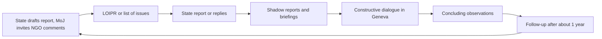

# 14.2 · Treaty Bodies and Shadow Reports

By the end of this lesson you will be able to read Israel's reporting calendar for each UN committee, pick the stage where your information has most effect, and draft a short shadow report that a committee member can turn into a question to the Israeli delegation.

## Why it matters

Every few years each committee questions an Israeli government delegation in public for a day and then publishes "concluding observations": a list of concerns and recommendations that ministries, courts, journalists and the Knesset quote for years. The committee members are independent experts with little time and no investigators. What they ask depends heavily on what civil society sent them. A tight, sourced, five-page submission from a small group can become a paragraph in the concluding observations. In the 2025 review of Israel by the Committee against Torture, submissions came from organisations as different as the Public Committee Against Torture in Israel coalition and the International Association of Jewish Lawyers and Jurists with the Hostages and Missing Families Forum — the committee read both.

## Key terms

| עברית | Transliteration | English |
|---|---|---|
| דוח תקופתי | doch tkufati | Periodic report: the state's report to a committee |
| דוח צל / דוח חלופי | doch tzel / doch chalufi | Shadow (alternative) report from civil society |
| רשימת שאלות | reshimat she'elot | List of issues (LOI): the committee's questions to the state |
| רשימת שאלות לפני הדיווח | reshimat she'elot lifnei hadivuach | List of issues prior to reporting (LOIPR), used in the simplified procedure |
| דיאלוג בונה | di'alog bone | Constructive dialogue: the public session with the state delegation |
| הערות מסכמות | he'arot mesakmot | Concluding observations (COs): the committee's findings and recommendations |
| הליך מעקב | halich ma'akav | Follow-up procedure: a short report on two to four priority recommendations, usually after a year |

## The law

> The Committee shall study the reports submitted by the States Parties to the present Covenant. It shall transmit its reports, and such general comments as it may consider appropriate, to the States Parties.

*Gist:* the committee studies the state's report and answers with its own report and comments — the concluding observations. (ICCPR art. 40(4); [UN Treaty Collection, IV-4](https://treaties.un.org/Pages/ViewDetails.aspx?src=TREATY&mtdsg_no=IV-4&chapter=4&clang=_en))

> The Committee requests the State Party to provide, by 28 November 2026, information on follow-up […] on incommunicado detention and enforced disappearance, on access to healthcare in detention and on the cessation of all policies in the Occupied Palestinian Territory that amount to torture or ill-treatment

*Gist:* the CAT chose four priority recommendations (the omitted part covers making torture a distinct offence) and asked Israel for a follow-up report within a year; other sources may send follow-up information too. (CAT/C/ISR/CO/6, para. 54, [UNISPAL copy](https://www.un.org/unispal/wp-content/uploads/2026/03/report.pdf))

> The Committee requests the State Party to submit its next periodic report, which will be its seventh, by 28 November 2029.

*Gist:* the committee sets the next due date in its concluding observations — that is where your planning starts. (CAT/C/ISR/CO/6, para. 57)

No treaty mentions shadow reports. Civil-society participation rests on each committee's working methods, which is why you must read the session page before you submit.

## How it works in practice

### The cycle

Under the **simplified reporting procedure**, which Israel accepted for several committees, the committee first sends a list of issues prior to reporting (LOIPR), and Israel's answers *are* its report. That makes input to the LOIPR the most powerful moment: if a topic is not in the list, the committee may never raise it.

### Israel's calendar (OHCHR database, 13 October 2026)

| Committee | Latest completed review | What comes next |
|---|---|---|
| CAT | 6th report, 83rd session, 11–12 Nov 2025; CAT/C/ISR/CO/6 | Follow-up information due 28 Nov 2026; 7th report due 28 Nov 2029 |
| CCPR (ICCPR) | 5th report, 134th session (March 2022); CCPR/C/ISR/CO/5 | Israel's follow-up report published 25 Sep 2026; LOIPR for the 6th report tentatively March 2028 |
| CEDAW | 6th report, 68th session (2017); CEDAW/C/ISR/CO/6 | 7th report submitted 23 Oct 2025; review at the 94th session (2027, to be confirmed) |
| CRC | Combined 5th–6th reports, 97th session (Sept 2024); CRC/C/ISR/CO/5-6 | LOIPR for the 7th–8th reports: date to be set by the committee |
| CERD | Combined 17th–19th reports, 100th session (Nov–Dec 2019); CERD/C/ISR/CO/17-19 | Combined 20th–23rd reports were due 2 Feb 2024; not shown as submitted |
| CESCR | 4th report, 66th session (Oct 2019); E/C.12/ISR/CO/4 | 5th report was due 31 Oct 2024; not shown as submitted |
| CRPD | Initial report, 29th session (Aug 2023); CRPD/C/ISR/CO/1 | Combined 2nd–5th reports: LOIPR expected Sept 2034, report Sept 2035, dialogue about March 2038 |

These dates move. Re-check them, and see [Current numbers](../../references/current-numbers.md) for the dates the course tracks.

**How to re-check any committee, in four clicks:** open the [Israel country page](https://tbinternet.ohchr.org/_layouts/15/TreatyBodyExternal/countries.aspx?CountryCode=ISR&Lang=EN) → scroll to the committee → open the newest "Reporting Cycle" row (the one with no session number, or "to be confirmed") → read the "Due date" column for the LOIPR, the state report and the concluding observations. Then open the committee's session page on ohchr.org and its "Information for civil society" note for the submission deadline, which is usually weeks to a few months before the session.

### Four ways in

1. **Before Israel writes.** The Ministry of Justice's international-law department invites NGOs to comment before it compiles a report and posts a general invitation on its website (5th ICCPR report, paras 2, 32–33). Ask to be on the list.
2. **The list of issues (LOI or LOIPR).** Two or three pages: your issue, the facts, and the **questions** you want the committee to ask.
3. **The review.** A shadow report with recommendations, sent by the deadline on the session page. NGOs may also brief committee members in a short private meeting before the dialogue; ask the secretariat.
4. **Follow-up.** After the concluding observations, send short information on whether Israel carried out the priority recommendations. The OHCHR database lists such "follow-up information from other sources".

### How to submit

- **Who may submit:** anyone — a group, an individual, an NGO, an amuta. No UN accreditation is needed.
- **Where:** the method in the session's civil-society note — usually the OHCHR online platform (account needed) or the committee secretariat's e-mail. Submissions to the **CRC** go through the Child Rights Connect platform.
- **Language:** English, French or Spanish. If you write in another language, add an English summary of up to two pages (ISHR).
- **Length and form:** no fixed limit for most committees, but short wins. Over five pages, add a contents list and a one-page summary. Follow the treaty article by article, so members can match your points to Israel's report.
- **Public by default.** Submissions are usually posted on the OHCHR website. If publication would put you or others at risk, ask OHCHR to keep the submission or your details confidential, **before** you send it.
- **Consent.** Get written consent from anyone you name or whose story can identify them.

> [!WARNING]
> Engage only where there is little risk of retaliation against you or the people in your report. Remove identifying details unless each person agreed in writing. Report intimidation linked to UN engagement (see lesson 14.4).

### Anatomy of a strong shadow report

Use the [shadow report outline](../../templates/shadow-report-outline.md):

1. Cover: who you are, contact, date, committee and session, public or confidential.
2. One-page summary: three to five issues, each with one question and one recommendation.
3. For each issue: the treaty article; what Israel's report or reply says (quote the paragraph); what is actually happening (facts, numbers, dates, sources); the gap; suggested question; suggested recommendation.
4. Follow-up on the committee's last concluding observations: which recommendations were carried out, partly, or not at all.
5. Sources, numbered.

## Worked example

**Situation.** "Bnot Brit" (invented), an Orthodox women's organisation in Jerusalem, works with women refused a get (מסורבות גט). In October 2026 it sees on the OHCHR database that CEDAW will review Israel's 7th report at its 94th session in 2027 (to be confirmed).

1. **Timing.** Israel already submitted its report (23 Oct 2025), so the LOIPR stage is over. The next chance is the review itself. Bnot Brit diarises: check the 94th-session page every month for the civil-society deadline.
2. **Read the state.** It downloads CEDAW/C/ISR/7 from the database and finds the paragraphs on personal status and rabbinical-court sanctions.
3. **Treaty map (14.1).** Art. 16 is reserved; art. 2 (policy to eliminate discrimination) and art. 15 (equality before the law) are not. The report says so in its first paragraph on the issue.
4. **Facts.** Its own anonymised case log (with written consent), rabbinical-court figures obtained by an FOI request (lesson 05.2), and the 2017 concluding observations on the same topic.
5. **Ask.** Question: "What measures has Israel taken since 2017 to ensure that rabbinical courts use available sanctions against get refusers, and with what results?" Recommendation: "Publish annual data on get-refusal cases and sanctions."
6. **Send.** Five pages plus a one-page summary, in English, through the method on the session page, marked public; no woman is named.

**Mirror test.** At the same session a secular feminist organisation may ask about civil marriage, and an Arab women's group about the investigation of murders of women. Each uses the same structure. The committee hears all of them.

## Do it yourself

### You need

- Your treaty map from lesson 14.1.
- The Israel country page on the OHCHR database.
- [shadow-report-outline.md](../../templates/shadow-report-outline.md).
- 90 minutes.

### Steps

1. Choose the committee closest to your issue. In the database, write down its last concluding observations (symbol and date) and its next step and due date.
2. Download the last concluding observations. Find every paragraph on your issue and copy the recommendation.
3. Download Israel's last report or follow-up report and find what it says on the same point.
4. Decide your stage: comments to the Ministry of Justice, LOIPR input, review, or follow-up. Write one sentence on why.
5. Draft a two-page shadow submission with the outline: summary, one or two issues, a question and a recommendation each, sources.
6. Mark every name or detail that could identify a person, and decide: consent obtained, anonymised, or removed.
7. Write down the exact submission route and deadline you will check for (session page, platform or e-mail).

### Template

[shadow-report-outline.md](../../templates/shadow-report-outline.md) — an English outline for a shadow report or a list-of-issues submission, with a treaty map, an issue table, a follow-up table and a sending checklist.

### How you know it worked

- A committee member who reads only your summary page knows which article, what the gap is, and what question to ask.
- Every factual claim has a source; your own data is marked as your own.
- Nobody is identifiable without written consent.

### Self-check

- [ ] Committee, stage and deadline (or how to find it) written down.
- [ ] Last concluding observations and Israel's last report quoted.
- [ ] Article-by-article structure; reservations acknowledged.
- [ ] Each issue ends in one question and one recommendation.
- [ ] Consent and confidentiality decided.

## Learn more

- **UN Audiovisual Library — Jane Connors, "The United Nations Human Rights Treaty Body System"** — FREE-FULL, no signup, English, 31 minutes: <https://legal.un.org/avl/ls/Connors_HR.html>. Watch for: how reports, lists of issues and concluding observations fit together. *Fallback:* chapter IV of the [OHCHR civil-society handbook (PDF)](https://www.ohchr.org/sites/default/files/Documents/Publications/NgoHandbook/ngohandbook4.pdf), the section on how civil society can engage (20 minutes). It dates from 2008, so check current methods on the session page.
- **ISHR Academy — Treaty Bodies: "Engaging prior to the Treaty Body review"** — FREE-FULL, no signup needed to read, English, 15 minutes: <https://academy.ishr.ch/learn/treaty-bodies/engaging-prior-to-the-treaty-body-review>. Then "Following up with Treaty Bodies" (10 minutes): <https://academy.ishr.ch/learn/treaty-bodies/following-up-with-treaty-bodies>. *Fallback:* the handbook chapter above.

## What goes wrong

| Mistake | Consequence | How to fix | How to avoid |
|---|---|---|---|
| Sending a long report after the session deadline | Not circulated to members | Send a one-page update to the country rapporteur via the secretariat; aim for follow-up | Diarise the deadline from the session page |
| Missing the LOIPR stage | Your issue is not in Israel's report and may never be raised | Send the issue for the review anyway, framed as a gap in the report | Watch the "LoIPR" due date in the database |
| A general essay on the situation | Members cannot use it | Rewrite as article → gap → question → recommendation | Use the outline |
| Naming a person without consent | Risk to the person; possible defamation exposure (Module 8) | Withdraw or ask OHCHR to remove it; anonymise | Written consent or anonymise before sending |
| Ignoring Israel's report | Looks one-sided; easy to dismiss | Quote Israel's paragraph and answer it | Read the state report first |
| Expecting a binding decision | Disappointment | Use the concluding observations in Israeli advocacy (letters, Knesset, petitions) | Plan the domestic follow-up in advance |

## Review

- Each committee reviews Israel in a cycle: report or LOIPR, dialogue, concluding observations, follow-up.
- Under the simplified procedure the list of issues prior to reporting is the most powerful moment for input.
- The OHCHR Israel country page shows every cycle, due date and past civil-society submission; the session page gives the deadline.
- A good shadow report follows the treaty, answers Israel's own report, and ends each issue in a question and a recommendation.
- Submissions are public unless you ask otherwise in advance; get consent before naming anyone.
