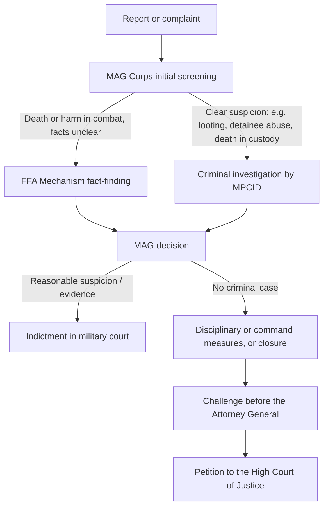

# 16.3 · Complementarity and Israeli Investigation Mechanisms

By the end of this lesson you will be able to explain why the ICC's jurisdiction depends on what Israel's own system does, file (in a dry run) a complaint about an alleged crime in the right Israeli channel and follow it to the High Court, and describe the debate over Israel's investigations without adopting any side's conclusion.

> [!NOTE]
> This lesson describes active proceedings and a live public dispute about Israel's investigations. The course takes no position. Each assessment is attributed to the body or author who made it; Israel's government's own description of its system is given in its own words.

## Why it matters

The ICC is a court of last resort. Under the Rome Statute, a case is inadmissible if a state with jurisdiction is genuinely investigating or prosecuting it. So the question "does the ICC have a role?" turns on a second question: "what are Israel's own investigators, prosecutors and courts doing about the same people and the same conduct?" Israel's government argues that its system is independent and effective; critics in Israel and abroad argue that it rarely leads to prosecution; others in Israel argue that investigations of soldiers go too far. For an activist, the practical point is that the domestic channels are where a complaint must start: a complaint to the police or the Military Advocate General creates a record, starts the clock, and is the step every international body will ask about.

## Key terms

| עברית | Transliteration | English |
|---|---|---|
| עקרון המשלימות | ekron hamashlimut | Complementarity: the ICC acts only where national systems do not genuinely do so |
| קבילות (של תיק) | kvilut | Admissibility of a case before the ICC (art. 17) |
| הפרקליט הצבאי הראשי (פצ״ר) | hapraklit hatzva'i harashi (patzar) | Military Advocate General (MAG) |
| מנגנון בירור עובדתי (מנגנון הבירור המטכ״לי) | manganon birur uvdati | General Staff Fact-Finding Assessment Mechanism (FFA Mechanism) |
| מצ״ח | metzach | Military Police Criminal Investigation Division (MPCID) |
| תחקיר מבצעי | tachkir mivtza'i | Operational debriefing (lessons learned; not a criminal investigation) |
| ועדת טירקל | va'adat Turkel | Turkel Commission (public commission on the 2010 flotilla incident; second report 2013) |
| תלונה במשטרה | tluna bamishtara | Police complaint |
| ערר על סגירת תיק | erer al sgirat tik | Complainant's appeal against a decision not to investigate or prosecute |

## The law

### Complementarity in the Rome Statute

> It shall be a permanent institution and shall have the power to exercise its jurisdiction over persons for the most serious crimes of international concern, as referred to in this Statute, and shall be complementary to national criminal jurisdictions.

*Gist:* the Court supplements national courts; it does not replace them. ([Rome Statute, art. 1](https://legal.un.org/icc/statute/english/rome_statute%28e%29.pdf))

> (a) The case is being investigated or prosecuted by a State which has jurisdiction over it, unless the State is unwilling or unable genuinely to carry out the investigation or prosecution;
> (b) The case has been investigated by a State which has jurisdiction over it and the State has decided not to prosecute the person concerned, unless the decision resulted from the unwillingness or inability of the State genuinely to prosecute;

*Gist:* a case is inadmissible when a state genuinely investigates or prosecutes it, or genuinely decides not to prosecute. "Unwilling" is tested by shielding the person, unjustified delay, or a lack of independence or impartiality (art. 17(2)(a)–(c)). (art. 17(1)(a)–(b))

> 2. Within one month of receipt of that notification, a State may inform the Court that it is investigating or has investigated its nationals or others within its jurisdiction with respect to criminal acts which may constitute crimes referred to in article 5 and which relate to the information provided in the notification to States. At the request of that State, the Prosecutor shall defer to the State's investigation of those persons unless the Pre-Trial Chamber, on the application of the Prosecutor, decides to authorize the investigation.

*Gist:* when an investigation opens, a state can ask the Prosecutor to defer to its own investigation. Israel's September 2024 request argued that the post-7 October investigation needed a new notice so it could use this provision; the Appeals Chamber disagreed in December 2025. (art. 18(2))

### Israeli law: complaints and the MAG

> כל אדם רשאי להגיש תלונה למשטרה על שבוצעה עבירה.

*Gist:* anyone may file a police complaint about an offence. ([חוק סדר הדין הפלילי, ס׳ 58](https://he.wikisource.org/wiki/חוק_סדר_הדין_הפלילי))

> על החלטה שלא לחקור או שלא להעמיד לדין, משום שנסיבות העניין בכללותן אינן מתאימות לפתיחה בחקירה או להעמדה לדין, לפי העניין, שלא נמצאו ראיות מספיקות או שנקבע שאין אשמה, רשאי המתלונן לערור כלהלן:

*Gist:* a complainant may appeal a decision not to investigate or not to prosecute, within a deadline (see [current numbers](../../references/current-numbers.md)). (ס׳ 64(א))

> שר הבטחון, על פי המלצת הרמטכ״ל, ימנה פרקליט צבאי ראשי שהוא פרקליט צבאי ובעל נסיון משפטי של שבע שנים לפחות.

*Gist:* the Minister of Defence appoints the MAG on the Chief of Staff's recommendation. Turkel recommended a different appointment process; it was never legislated. ([חוק השיפוט הצבאי, ס׳ 177(א)](https://he.wikisource.org/wiki/חוק_השיפוט_הצבאי))

> (4) רשאי לצוות על עריכת חקירה מוקדמת בכל מקרה שלדעתו נעברה עבירה שבית דין צבאי מוסמך לדון בה;

*Gist:* the MAG may order an investigation whenever, in his view, an offence within military-court jurisdiction was committed. (ס׳ 178(4))

## How it works in practice

### Route 1: a complaint about alleged military misconduct

The IDF describes its process as follows ([IDF, Addressing Alleged Misconduct, 2024](https://israelihl.mfa.gov.il/sites/default/files/2025-08/8%20-%20Addressing%20Alleged%20Misconduct%20in%20the%20Context%20of%20the%20War%20in%20Gaza%20_%20IDF.pdf); [IDF Military Justice System, 2024](https://israelihl.mfa.gov.il/sites/default/files/2025-08/9%20-%20The%20IDF%20Military%20Justice%20System%20_%20IDF.pdf)):

- **Who may complain.** Any person, at any police or MPCID station, in person or in writing. People outside Israel may complain to the MAG through the liaison mechanism with the Palestinian Authority, through an NGO, or through a lawyer, who need not be Israeli.
- **Screening.** The IDF says a death or injury of a civilian in combat "in most cases" does not by itself show criminal conduct, so such cases usually go to the **FFA Mechanism**, headed by a major general outside the chain of command. Its materials are privileged by law.
- **Automatic investigations.** The death of a detainee in IDF custody is investigated criminally at once, by long-standing policy.
- **Outcome.** The complainant is notified of the MAG's decision. The MAG's time limit for deciding is set by an internal guideline (see [current numbers](../../references/current-numbers.md)).
- **Review.** The Attorney General may review MAG decisions and a complainant or NGO can challenge them before the AG; the High Court of Justice can review both (lesson 05.7).
- **Figures published by the IDF.** By August 2024 the MAG had ordered 74 criminal investigations relating to the war (44 on deaths of detainees) and over a thousand incidents had been referred to the FFA Mechanism. Lawfare (April 2026) cites IDF figures from May 2025 of about 1,500 examinations, about 60 criminal investigations and two prosecutions.

### Route 2: an alleged crime by a civilian (settlers, Palestinians, anyone)

1. **Police complaint** (s. 58) at a station, with evidence (lesson 07.1; documentation in Module 17).
2. **Investigation** by the Israel Police; in the West Bank, the Judea and Samaria District.
3. **Closure notice.** If the file is closed, the notice states the reason ("no guilt", "insufficient evidence", "circumstances as a whole").
4. **Appeal** (s. 64) within the deadline in [current numbers](../../references/current-numbers.md), to the prosecution level named in the section; request the investigation material first.
5. **High Court petition** against the final decision, if it is unreasonable (lesson 05.7).

Complaints against police officers go to the Department for Investigation of Police Officers (lesson 06.4), not to the police itself.

### Turkel's recommendations: what was done

| Turkel (2013) | Ciechanover team (2015) | State Comptroller (2018) and later |
|---|---|---|
| 1. Legislate war crimes where Israeli law has gaps | AG decided to promote bills on torture and crimes against humanity | No bills had been submitted (2018). No general war-crimes statute was found in October 2026 |
| 2. Criminal responsibility of commanders and civilian superiors | Further examination needed | No bills had been submitted (2018) |
| 5. A permanent, separate fact-finding mechanism | Adopted | The FFA Mechanism was set up during the 2014 war; the Comptroller found it worked "in good faith" but with flaws: no legal advisers in field teams, and over 80% of examinations exceeded the set timetables |
| 6. A time limit for the MAG's decision to investigate | A guideline with a time limit (see current numbers) | The guideline had not yet been published (2018) |
| 7. MAG independence and appointment | AG consent to the appointment (adopted by the Security Cabinet in 2016) | Not legislated; IDI notes s. 177 was never amended (2025) |

Turkel's overall conclusion was that Israel's mechanisms "generally comply with the obligations of the State of Israel under the rules of international law", with improvements needed in several areas (Turkel II, para. 29).

### 2025–2026: the Sde Teiman affair

- **February 2025:** the MAG indicted five reservists for the alleged abuse of a Palestinian detainee at Sde Teiman in July 2024.
- **31 October 2025:** the MAG resigned, admitting to having approved the release of a video of the incident to the media; a criminal investigation into the leak and an alleged cover-up followed (IDI).
- **10 November 2025:** a new MAG was appointed.
- **12 March 2026:** the new MAG withdrew the indictments, citing evidential difficulties, procedural flaws arising from the leak, and delay (Lawfare).

Reactions differed: the Prime Minister and Defence Minister welcomed the withdrawal, the Defence Minister calling the original charges a "blood libel"; Professors Shany and Cohen wrote that the withdrawal could complicate Israel's ability to claim complementarity before international and foreign courts.

### Who says what on complementarity

| Who | Position |
|---|---|
| Government of Israel | Israel has primary jurisdiction and conducts genuine investigations; its Article 18 submission (Sept 2024) asked the Court to respect them. The MAG is "subject only to the law" and is reviewed by the AG and the Supreme Court (IDF, 2024) |
| ICC Prosecutor (21 Nov 2024) | "The door to complementarity continues to remain open", which "requires genuine domestic investigations and any necessary prosecution of the same individuals for substantially the same conduct" |
| ICC Appeals Chamber (15 Dec 2025) | No new art. 18(1) notice was required for post-7 October conduct, so no new deferral window opened |
| UN Commission of Inquiry (A/HRC/62/22, May 2026) | Found a consistent pattern of failure to investigate and punish settler violence, citing Yesh Din's figure that about 93.6% of police investigations in 20 years ended without indictment; called on states to cooperate with the ICC |
| Israel Democracy Institute (Shany and Cohen, 2024) | A state commission of inquiry empowered to review senior decisions could meet the Statute's test; "it is not sufficient merely to assert that investigations are ongoing" |
| B'Tselem | Israel accords itself "almost complete criminal and civil immunity" |
| Israeli critics from the right | Investigations and indictments of soldiers harm the IDF; the Defence Minister called the Sde Teiman charges a "blood libel" |

The legal question for the ICC is narrow: same person, substantially the same conduct, genuine proceedings. General statistics support arguments but do not decide a specific case.

## Worked example

**Situation.** Fatima, a farmer near a village south of Nablus, finds 40 olive trees cut on her land. She has photos with dates, a neighbour who saw people coming from the direction of an outpost, and the time of the incident.

1. **Channel.** A suspected crime by civilians: Route 2. She files a police complaint (s. 58) at the nearest station, through a lawyer or an NGO if access is difficult, attaching the photos and the witness's name and number. She asks for and keeps the confirmation of the complaint with its number.
2. **Follow-up.** After two months she asks in writing about the status.
3. **Closure.** The file is closed for "unknown offender". She requests the investigation material and files an appeal (s. 64) within the deadline, noting the investigative steps not taken (no visit to the scene, the witness not questioned).
4. **Record.** Every step is dated. If she later writes to a UN body (lesson 14.4) or the ICC (lesson 16.5), the record shows what Israel's system did, which is exactly what complementarity asks.

**Mirror test.** Yossi, a farmer in the Jordan Valley, finds his greenhouses burned and suspects people from a nearby Palestinian village. The route is identical: police complaint, follow-up, appeal against closure, petition. If the suspected perpetrators had been soldiers, both would use Route 1: a complaint to the MAG (directly, through the police or MPCID, or through an NGO or lawyer).

## Do it yourself

> [!IMPORTANT]
> Act in your own name only. This is not legal advice — check current rules before filing. The default here is a dry run: do not file a complaint unless the facts are real and you are the victim, a witness, or acting for a person who asked you to.

### You need

- A real or realistic incident: an alleged offence by soldiers, police, settlers, Palestinians or any civilian.
- The [formal letter template](../../templates/formal-letter.md) and the [police complaint template](../../templates/police-complaint.md) (for complaints about police officers).
- The IDF and State Comptroller documents in the sources.
- 90 minutes.

### Steps

1. Decide the channel: Route 1 (MAG) if soldiers are suspected; Route 2 (police) for civilians; the Department for Investigation of Police Officers for police officers.
2. Draft a short complaint in Hebrew with the formal letter template: who you are, what happened (date, time, place), who was harmed, what evidence exists and where it is kept, what you ask (an investigation, preservation of evidence, notification of the decision).
3. Write the follow-up plan: when you will ask about status, and who decides on an appeal if the file is closed.
4. Fill a "complementarity record" table: date | step | body | reference number | outcome.
5. Read the State Comptroller's 2018 summary on the FFA Mechanism (pp. 11–13) and write two lines on what it says about timing.
6. Write a five-row "who says what" on Israel's investigations, using sources from at least three different perspectives.

### Template

[formal-letter.md](../../templates/formal-letter.md) for the complaint letter; [police-complaint.md](../../templates/police-complaint.md) only for complaints about police officers.

### How you know it worked

- Your complaint is in the right channel and states facts, not labels.
- Your record table would let a stranger see exactly what was done and when.
- Your "who says what" uses the same verbs for every side.

### Self-check

- [ ] Channel chosen correctly (MAG, police, or police-misconduct unit).
- [ ] Complaint asks for evidence to be preserved and for notification of the decision.
- [ ] Appeal deadline taken from current numbers, not from memory.
- [ ] Turkel implementation described from the 2015 and 2018 sources.
- [ ] Positions attributed; no conclusion of my own on whether Israel's system is "genuine".

## Learn more

- **UN Audiovisual Library — Sarah Nouwen, "Complementarity" (14/11/2019)** — FREE-FULL, no signup, English, 49 minutes: <https://legal.un.org/avl/ls/Nouwen_CLP.html>. Watch for: complementarity as a "big idea" versus the narrow admissibility test in art. 17 ("same person, same conduct"). *Fallback:* Israel Democracy Institute, ["In Search of Complementarity"](https://en.idi.org.il/articles/54878) (15 minutes).
- **State Comptroller, Operation "Protective Edge" report (2018), summary pp. 3–14** — FREE-FULL, no signup, English, 30 minutes: <https://library.mevaker.gov.il/sites/DigitalLibrary/Documents/special/2018-03-TsukEitan-HE/2018-03-TsukEitan-EN/2018-03-TsukEitan-ENG-Report.pdf>. *Fallback:* the Ciechanover report's table of contents and Recommendations 1, 5 and 6.

## What goes wrong

| Mistake | Consequence | How to fix | How to avoid |
|---|---|---|---|
| Going straight to the ICC or the UN without any domestic complaint | International bodies ask what was done locally; you have no record | File the domestic complaint now and keep the reference | Start every file with Route 1 or Route 2 |
| Complaining about soldiers to the police only, with no copy to the MAG | Delay while the complaint is transferred | Send it to the MAG Corps as well, through an NGO or lawyer if needed | Choose the channel by who the suspect is |
| Missing the appeal deadline after closure | The decision becomes final; only a petition remains | Ask for an extension and explain; petition if refused | Diary the deadline the day the notice arrives |
| Treating an operational debriefing or an FFA review as a criminal investigation | You misstate what Israel did | Ask the MAG whether a criminal investigation was opened | Ask for the decision in writing |
| Using national statistics as proof about a specific case | Weak argument; complementarity is case-specific | Show what happened in this case | Record the steps for the same person and conduct |

## Review

- Under arts 17–18, a case is inadmissible at the ICC if a state genuinely investigates or prosecutes the same person for substantially the same conduct.
- Alleged military misconduct goes to the MAG: screening, an MPCID investigation or FFA fact-finding, a decision, then AG review and the High Court.
- Alleged crimes by civilians go to the police (s. 58); closure can be appealed (s. 64) and then petitioned.
- Turkel's FFA recommendation was implemented; war-crimes and command-responsibility legislation and the MAG appointment reform were not, according to the 2018 State Comptroller report and later sources.
- The complementarity debate has many sides; attribute each assessment and keep your own file case-specific.
