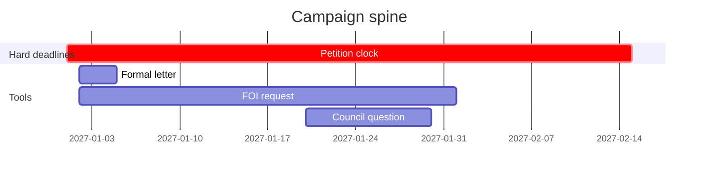

# Legal Strategy Map (מפת אסטרטגיה משפטית)

A one-to-two page plan that turns a theory of change into tools, order, deadlines, cost and risk. Used in lesson [20.2](../lessons/module-20/lesson-02.md) and as part 2 of the [capstone case study](../projects/m20-capstone.md). It builds on your [theory of change](theory-of-change.md). For use in your own name, or in the name of a group that authorised you; this is not legal advice.

Copy the blocks below into your own document. Take every fee and deadline from [Current Numbers](../references/current-numbers.md) on the day you fill it in, and write that date at the top.

> Numbers checked on: …
>
> Goal (from the theory of change): …

## 1. Tools

One row per tool. Use the decision matrix in lesson 20.2 for the forum, cost, clock, time, chance and risk.

| # | Tool | Lesson | Family | Precondition it creates | Forum | Cost and clock | Typical time | Chance (high / medium / low) | Main risk | Real or dry run |
|---|---|---|---|---|---|---|---|---|---|---|
| 1 | Formal letter | 02.5 | Information | | | | | | | |
| 2 | FOI request | 05.2 | Information | | | | | | | |
| 3 | | | | | | | | | | |
| 4 | | | | | | | | | | |
| 5 | | | | | | | | | | |

Families: information · oversight · pre-litigation and litigation · Knesset and local government · public communication · international.

Capstone minimum: at least four tools from at least three families; at least three real actions in your own name.

## 2. The deadline spine

Write the hard deadlines first (set by law), then place the soft tools before them.

| Month | Hard deadline (law and section) | Soft tools in this month | Milestone to communicate |
|---|---|---|---|
| 1 | | | |
| 2 | | | |
| 3 | | | |
| 4 | | | |
| 5 | | | |
| 6 | | | |

Optional, as a diagram:

## 3. Sequencing check

- [ ] Rule 1 — I ask first, in writing.
- [ ] Rule 2 — Facts (FOI, documentation) come before arguments.
- [ ] Rule 3 — Soft tools sit inside the hard deadlines.
- [ ] Rule 4 — One forum decides each question; other forums are for pressure and records.
- [ ] Rule 5 — I communicate at milestones (a fact on the record), not at every step.

## 4. Risk register

| Tool | Main risk | Likelihood in my case | What I do to reduce it | Who I call if it happens |
|---|---|---|---|---|
| | Costs order | | | |
| | Defamation or privacy claim | | | |
| | Detention or arrest | | | |
| | Missed deadline | | | |
| | Personal safety or harassment | | | |

## 5. Budget

| Item | Amount (from Current Numbers) | Exemption or alternative |
|---|---|---|
| FOI fees | | |
| Court or appeal fees | | Fee-exemption request (lesson 11.6) |
| Affidavit certification | | |
| Lawyer's limited-scope review | | Clinic or pro bono (lesson 18.5) |
| Printing, travel, registered mail | | |
| **Total** | | |

## 6. Tools I will not use, and why

| Family or tool | Why not (one line) |
|---|---|
| | |
| | |

## 7. In whose name

> Own name / group [name], decision of [date]. Lawyer or clinic review planned before: …
