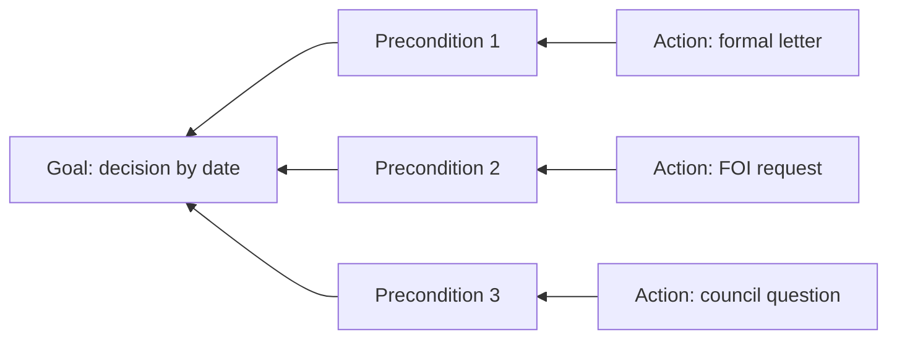

# Theory of Change (תאוריית שינוי לקמפיין)

A one-to-two page worksheet for choosing a campaign cause and explaining why your actions should lead to the decision you want. Used in lesson [20.1](../lessons/module-20/lesson-01.md) and as part 1 of the [capstone case study](../projects/m20-capstone.md). For use in your own name, or in the name of a group that authorised you; this is not legal advice.

Copy the blocks below into your own document and fill them in. Update it whenever the campaign teaches you something new, and keep the old versions: the changes are part of your case study.

## 1. Candidate causes and the six filters

Score each filter ✓ (passes), ~ (passes with a fix) or ✗ (fails), with one line of evidence.

| Filter | Cause A: … | Cause B: … | Cause C: … |
|---|---|---|---|
| 1. Real — a concrete, documented problem now | | | |
| 2. Yours — I can act in my own name or for a group that authorised me | | | |
| 3. Decided by someone — a person or body has the power to fix it | | | |
| 4. Legally hooked — a statute, regulation, procedure or ruling applies | | | |
| 5. Timely — clocks still open; a decision point ahead | | | |
| 6. Within capacity — hours and money for 3–9 months | | | |

> Chosen cause, and why the others lost:
>
> …

## 2. The goal

> By [date], [decision-maker] [makes this decision], or gives a reasoned written decision explaining why not.
>
> …

| Field | Entry |
|---|---|
| Decision-maker (official or body) | |
| Source of their power (law and section) | |
| Next decision point (budget, plan, renewal, committee session) | |
| Hard deadlines already running (see [Current Numbers](../references/current-numbers.md)) | |

## 3. The backwards map

Start from the goal and work backwards. Two to four preconditions; at least one action for each.

| Precondition (what must be true just before the decision) | Action that creates it | Course lesson | Indicator (how I will know it is in place) |
|---|---|---|---|
| The decision-maker knows the facts, in writing | | | |
| The decision-maker is legally required or pressured to decide | | | |
| There is no good reason to refuse (or the reason is exposed) | | | |
| Refusing has a cost (court, oversight finding, council or Knesset, public attention) | | | |

Optional: draw it as a diagram.

## 4. Assumptions and their tests

| Assumption (what I believe that might be false) | Earliest action that tests it | Date | Result |
|---|---|---|---|
| | | | |
| | | | |
| | | | |

## 5. In whose name, and where I stop

> I act in my own name / in the name of [group], which authorised the campaign on [date] (attach the decision).
>
> Where the campaign touches other people's personal cases, I give general information and refer them to: …
>
> I will get a lawyer, clinic or Legal Aid before: …

## 6. The other side

> The strongest argument against my goal, in two sentences, with who makes it (attributed):
>
> …

## 7. Version history

| Version | Date | What changed and why |
|---|---|---|
| 1 | | First draft |
